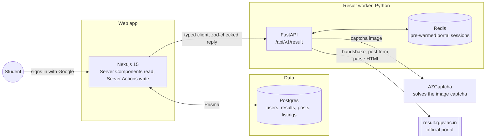

<div align="center">


<br>

**Exam results, notes and papers, and a campus network for RGPV University, Bhopal.<br>Every profile is tied to a real enrollment number, proved by fetching that student's own result.**

<br>

[](https://nextjs.org)
[](https://react.dev)
[](https://www.typescriptlang.org)
[](https://tailwindcss.com)
[](https://www.prisma.io)
[](https://authjs.dev)
[](https://fastapi.tiangolo.com)
[](https://turbo.build)
<br>
[](#how-far-to-trust-it)
[](#the-rules-it-keeps)
[](#licence)

[What it does](#what-it-does) · [The rules it keeps](#the-rules-it-keeps) · [How far to trust it](#how-far-to-trust-it) · [How it works](#how-it-works) · [Run it yourself](#run-it-on-your-machine) · [Docs](docs)

</div>

<br>

<p align="center">
  
</p>

## Why RGPV Connect

A college WhatsApp group has two hundred people in it, and nobody can say who is really a student. Results day sends everyone to the same slow portal. Notes and old papers are shared once and scroll away.

RGPV Connect keeps the useful parts in one place. It looks up a semester result from the official portal. It lists notes and previous-year papers by subject. And it puts a campus network on top, with one property a chat group cannot copy: **every profile is bound to a real RGPV enrollment number.** To get verified, a student enters their number, the result worker fetches their actual result from RGPV, and the number itself is decoded into college, branch and batch. Nothing about where you study is typed by hand.

It started as a plain results-lookup site. This repository is the rewrite as a free, open-source monorepo.

## What it does

| | |
|---|---|
| **Result lookup** | Any signed-in user can type an enrollment number and a semester (1 to 8) and get the name, SGPA, CGPA, pass or fail status and the full subject table. The result worker fetches it live from `result.rgpv.ac.in`. |
| **My Results** | A verified student syncs every semester they could have sat, worked out from their admission year. Results are cached in Postgres. A semester already recorded as PASS or FAIL is never fetched again, so a repeat sync is usually free. |
| **SGPA calculator** | Credits and a grade per subject on RGPV's 10-point scale (A+ is 10, F is 0). The SGPA updates as you type. |
| **Verified profiles** | Verification fetches a real result for the number, which proves it belongs to you. The number `CCCCBBYYNNN` is then decoded: college code, branch, admission year, graduating batch. One account per enrollment number. |
| **Notes and papers** | Approved PDFs listed by subject, highest rated first. Browsing is built. Uploading and rating from the web app are not built yet, though the database already has the tables for them. |
| **Feed** | Posts from your college, with likes and comments. Only verified students can post. |
| **Directory and follows** | Verified students browse their college, or the whole university, search by name and follow each other. |
| **Groups** | College, branch and interest groups that a verified student can join or leave. Groups are not created automatically yet. |
| **Direct messages** | One-to-one threads with an unread count per member, and in-app notifications for follows, likes, comments and messages. |
| **Jobs and internships** | Recruiters and admins post. Students filter by full-time, internship or part-time. |
| **Campus market** | Buy and sell within your college: books, electronics, notes, hostel goods. Prices are stored in paise. There is no payment flow and no commission. |

## The rules it keeps

- **Every verified profile is backed by a fetched result.** Typing a number is not enough. The worker must return that student's result from RGPV.
- **College, branch and batch are derived, never self-reported.** They come from the enrollment number, parsed on the server by `@rgpv/shared` and mirrored in Python in the worker, so both sides decode the same way.
- **It is free, and stays free.** No paid tier, no commission, no ads. The last premium code path was removed in the migration `remove_premium_tier`. Contributions that add paywalls are declined in [`CONTRIBUTING.md`](CONTRIBUTING.md).
- **The result fetcher is best effort.** Every caller must degrade cleanly when the worker is down or the portal rejects a request.
- **Secrets stay out of the browser.** The captcha solver key lives only in the worker's `.env`, never in the web app.
- **Student data is treated as personal data.** Report a vulnerability privately, as [`SECURITY.md`](SECURITY.md) asks. India's DPDP Act applies.
- **Not affiliated with the university.** Result data belongs to RGPV.

## How far to trust it

> [!IMPORTANT]
> **RGPV Connect is early.** The code runs end to end on a laptop with the seeded demo user, and the worker has fetched a real result from the live portal. **No student has signed up yet**, and there is no public address. The launch plan in [`docs/launch-free.md`](docs/launch-free.md) is to open at one college first, UIT-RGPV Bhopal, on free hosting tiers.

Things to know before relying on it:

- **The result worker scrapes a government portal.** `result.rgpv.ac.in` is a legacy ASP.NET WebForms site behind a five-character image captcha. The worker replays the full session, pays [AZCaptcha](https://azcaptcha.com) about $0.40 per thousand captchas to solve it, waits about six seconds because the portal rejects a form posted sooner, and parses the HTML. A change to the portal's markup breaks it. Scraping may also raise terms-of-use questions for any commercial deployment.
- **A single lookup takes about 3 to 11 seconds** with AZCaptcha. The Tesseract fallback takes 10 to 50 seconds and is for offline development only.
- **The enrollment parser accepts a three-digit serial** (`0751BT16012`). The examples in [`docs/knowledge.md`](docs/knowledge.md) show newer numbers with a four-digit serial (`0198CS231019`). The worker will fetch those, but verification will reject them until the parser is widened.
- **Result lookup needs a sign-in.** The middleware only leaves `/` and `/login` open. Lookup without an account is on the roadmap, not in the code.
- **Only Google sign-in exists today.** Phone OTP and email links are planned.
- **There are no end-to-end tests.** Unit tests cover the enrollment parser and the worker's parser, captcha client, session pool and result service.

## How it works



The web app reads from Postgres in Server Components and writes through Server Actions, which check the session, validate with Zod and revalidate the path. It talks to the worker through one client, `apps/web/src/lib/result-worker.ts`, which checks every reply against the shared `semesterResultSchema` before the UI sees it. The worker keeps a pool of warmed-up portal sessions in Redis, because the portal only accepts a form some seconds after the session was opened; a pooled session has already waited.

| Part | What it uses |
|---|---|
| Web app | [Next.js 15](https://nextjs.org) App Router, [React 19](https://react.dev), TypeScript strict, [Tailwind CSS 3](https://tailwindcss.com) with [shadcn/ui](https://ui.shadcn.com) and Radix |
| Signing in | [Auth.js v5](https://authjs.dev) with Google and JWT sessions. An edge-safe config guards routes in middleware; the Node config upserts the user in Postgres |
| Database | Postgres through [Prisma 5](https://www.prisma.io). Schema and seed in `packages/db` |
| Shared logic | `packages/shared`: the enrollment parser, branch codes, Zod schemas and domain types, with no React or Prisma in it |
| Result worker | Python 3.11, [FastAPI](https://fastapi.tiangolo.com), `requests`, Redis session pool, [AZCaptcha](https://azcaptcha.com) with Tesseract as a fallback, `slowapi` rate limit on the bulk endpoint |
| Monorepo | pnpm 9 workspaces and [Turborepo](https://turbo.build). The Python service is a workspace package whose scripts wrap pip, uvicorn, pytest, ruff and mypy |
| Checks | ESLint, Prettier, Vitest for TypeScript; Ruff, mypy, pytest for Python; both run in GitHub Actions on every push and pull request |
| Hosting | `vercel.json` builds the web app on [Vercel](https://vercel.com). The worker has a Dockerfile; the docs plan Fly.io for it |

## Run it on your machine

You need Node.js 20 or newer, pnpm 9, Python 3.11 or newer, Docker for Postgres and Redis, and an [AZCaptcha](https://azcaptcha.com) API key if you want real results. Tesseract is only needed if you set `CAPTCHA_PROVIDER=tesseract`.

```bash
git clone https://github.com/vishalmeena2211/rgpv-connect-platform.git && cd rgpv-connect-platform
```

```bash
pnpm install
```

```bash
docker compose -f infra/docker-compose.yml up -d postgres redis
```

```bash
cp packages/db/.env.example packages/db/.env && pnpm db:generate && pnpm db:migrate && pnpm db:seed
```

```bash
pnpm worker:setup
```

```bash
cp services/result-worker/.env.example services/result-worker/.env
```

Open `services/result-worker/.env` and set `AZCAPTCHA_API_KEY`. Then:

```bash
cp apps/web/.env.example apps/web/.env.local
```

```bash
pnpm dev
```

The web app is at http://localhost:3000 and the worker's API docs at http://localhost:8000/docs. The seed creates four Bhopal colleges, a small B.Tech catalogue and a verified demo student, `0151CS21001`, so the app runs without any Google credentials. Google sign-in needs `AUTH_GOOGLE_ID` and `AUTH_GOOGLE_SECRET` in `apps/web/.env.local`; generate `AUTH_SECRET` with `openssl rand -base64 32`.

To call the worker directly:

```bash
curl -s -X POST http://localhost:8000/api/v1/result -H 'content-type: application/json' -d '{"enrollment":"0151CS21001","semester":1}'
```

Every setting, the worker's endpoints and the troubleshooting list are in [`docs/knowledge.md`](docs/knowledge.md).

## Repository layout

| Folder | What is in it |
|---|---|
| [`apps/web/`](apps/web) | The Next.js app. Feature folders under `src/features/*`, UI primitives under `src/components/ui`. See [`apps/web/README.md`](apps/web/README.md) |
| [`packages/shared/`](packages/shared) | Enrollment parser, branch codes, Zod schemas, domain types |
| [`packages/db/`](packages/db) | Prisma schema, migrations, client singleton and the seed |
| [`packages/config/`](packages/config) | Shared ESLint, TypeScript and Tailwind presets |
| [`services/result-worker/`](services/result-worker) | The FastAPI worker: session handshake, captcha, fetch, parse, Redis pool. See its [README](services/result-worker/README.md) |
| [`infra/`](infra) | `docker-compose.yml` for Postgres, Redis, the worker and the web app |
| [`docs/`](docs) | [Architecture](docs/architecture.md), the [portal and worker reference](docs/knowledge.md), the [strategy](docs/strategy.md) and the [free-tier launch guide](docs/launch-free.md) |

New here? Read [`docs/architecture.md`](docs/architecture.md) first, then [`docs/knowledge.md`](docs/knowledge.md) for how a result is actually fetched.

## Roadmap

- [x] Monorepo with web app, shared package, database package and Python worker
- [x] Enrollment verification by fetching a real result, with college, branch and batch decoded from the number
- [x] Result lookup, My Results sync with caching, SGPA calculator
- [x] Feed, directory, follows, groups, direct messages, notifications, jobs, market
- [x] Premium code paths removed; the project is free
- [x] Redis session pool wired into every fetch
- [ ] Widen the enrollment parser to four-digit serials
- [ ] Result lookup without an account
- [ ] Notes and papers upload, with a moderation queue
- [ ] Email magic-link and phone OTP sign-in
- [ ] Installable app shell and offline results
- [ ] Web Push on results day
- [ ] Share card for a result, with a WhatsApp link
- [ ] Self-hosted, privacy-safe analytics
- [ ] Privacy notice and a data-deletion endpoint
- [ ] Placement outcomes by branch and batch, published as a public good

The thinking behind the order is in [`docs/strategy.md`](docs/strategy.md).

## Contributing

**If you study at an RGPV college:** the most useful things are to try verifying with your own number and say what happened, and to contribute notes, papers or syllabus content.

**If you write code:** read [`CONTRIBUTING.md`](CONTRIBUTING.md) first. Reads go in Server Components, writes in Server Actions. Money is integer paise. A schema change ships with its migration. Run `pnpm lint && pnpm typecheck && pnpm test` before you push; CI runs the same. Keep the words plain: the app talks to students, not to developers.

Please do not add paywalls or paid integrations. By taking part you agree to the [Code of Conduct](CODE_OF_CONDUCT.md).

## Credits

RGPV Connect stands on other people's work:

- **Result data** comes from the official portal, [result.rgpv.ac.in](https://result.rgpv.ac.in/Result/BErslt.aspx), and belongs to RGPV.
- **Captcha solving** by [AZCaptcha](https://azcaptcha.com), with [Tesseract](https://github.com/tesseract-ocr/tesseract) as the offline fallback.
- Built with [Next.js](https://nextjs.org), [Prisma](https://www.prisma.io), [shadcn/ui](https://ui.shadcn.com), [Auth.js](https://authjs.dev), [FastAPI](https://fastapi.tiangolo.com) and [Turborepo](https://turbo.build).

## Licence

**[MIT](LICENSE)**, copyright 2026 RGPV Connect contributors. Use it, change it and share it, keeping the copyright notice. Result data is RGPV's and is not covered by this licence.

## Words used here

| Word | What it means |
|---|---|
| **Enrollment number** | The eleven-character student number RGPV issues, `CCCCBBYYNNN`. `0751BT16012` is college 0751, Biotechnology, admitted 2016, serial 012 |
| **Verified** | A profile whose enrollment number returned a real result from the portal, and whose college, branch and batch were decoded from it |
| **College code** | The first four digits of the number. `0151` is UIT-RGPV, the university's own institute |
| **Batch** | The graduating year, admission year plus four for a B.Tech |
| **SGPA, CGPA** | Semester and cumulative grade point averages on RGPV's 10-point scale |
| **Result worker** | The Python service that fetches a result from the portal: handshake, captcha, post, parse |
| **Session pool** | Portal sessions the worker opens ahead of time and keeps in Redis, so a lookup does not wait for the handshake and the portal's submit window |

<br>

<div align="center">
<sub>Made for RGPV students, by students. Not affiliated with or endorsed by Rajiv Gandhi Proudyogiki Vishwavidyalaya.</sub>
</div>
